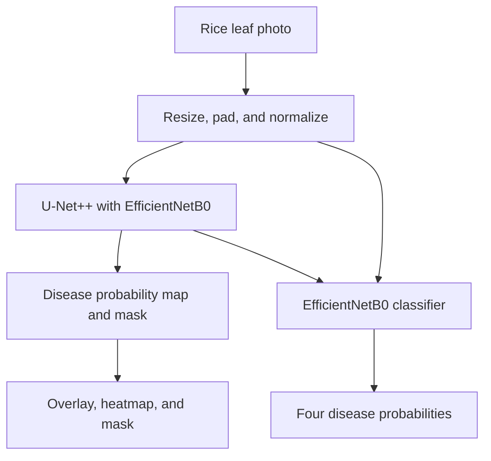
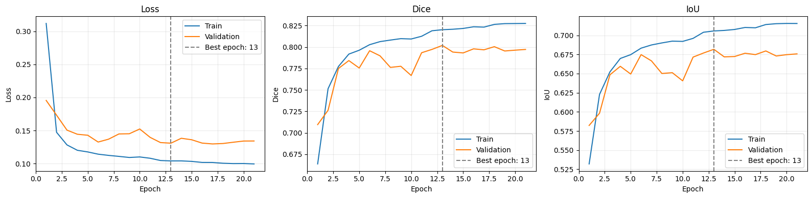
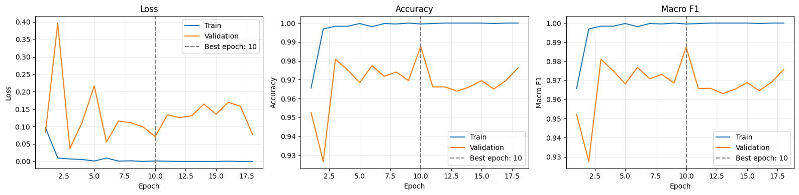
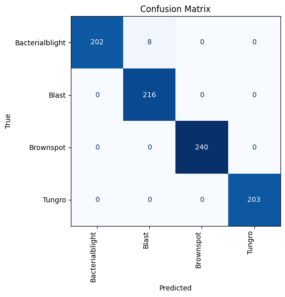
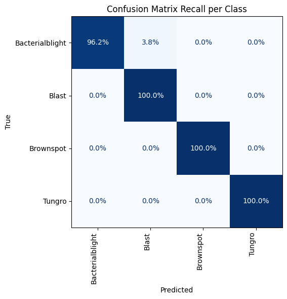
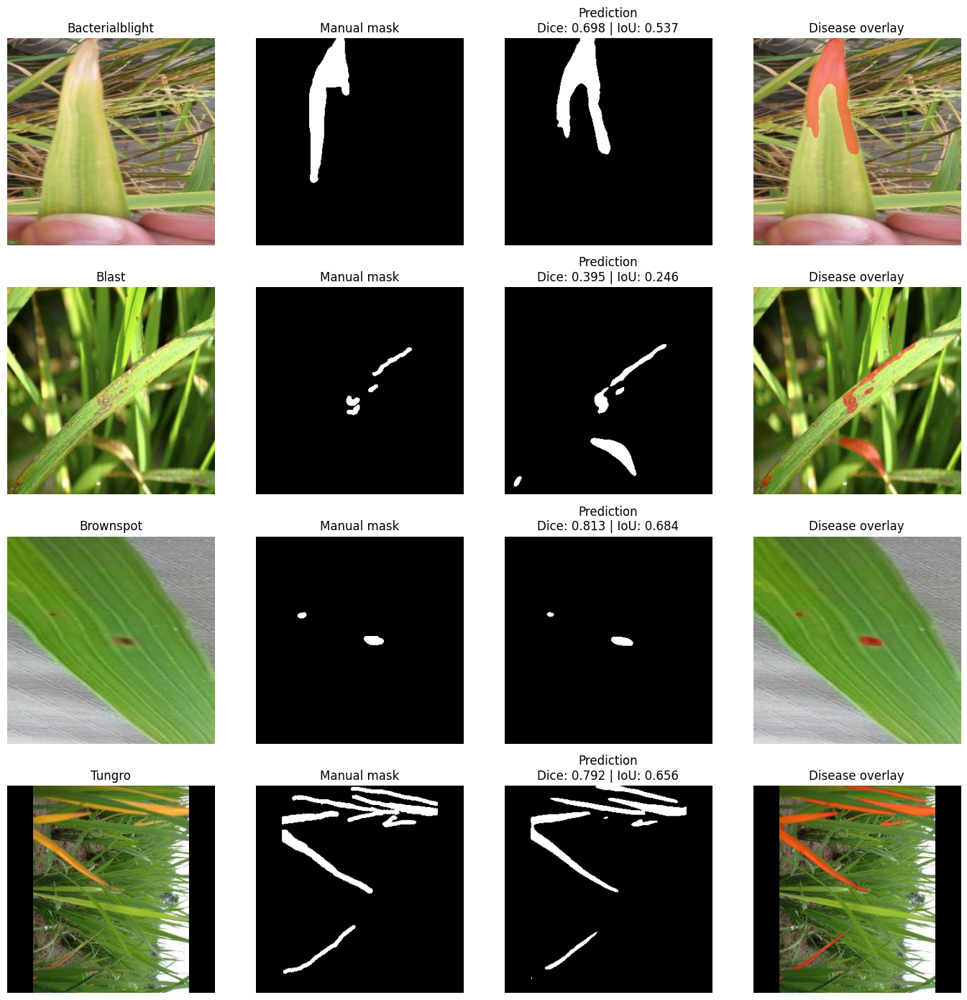
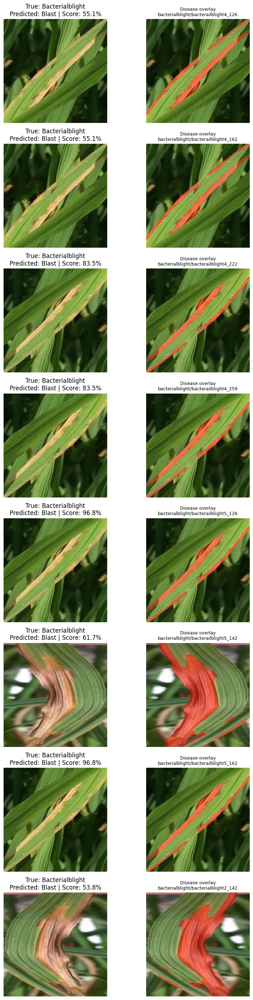
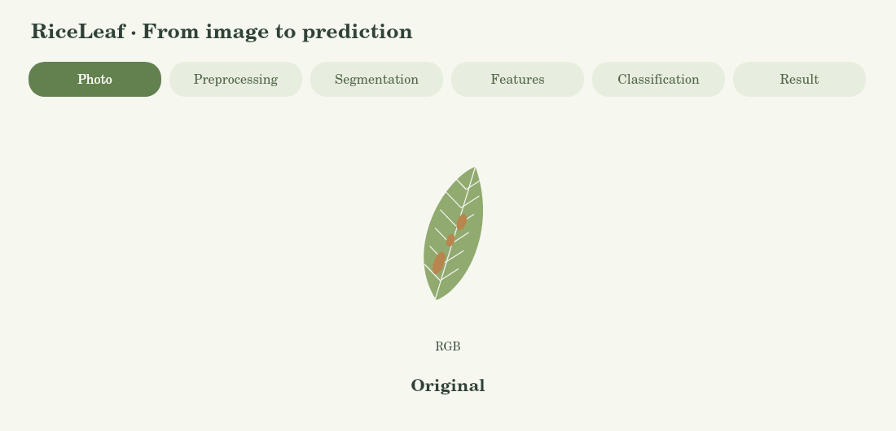
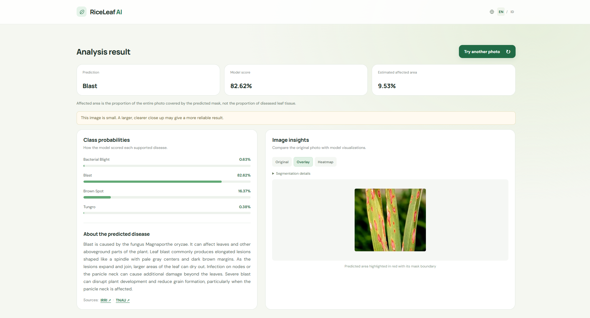

<div align="center">

# RiceLeaf

### Rice leaf disease classification and segmentation

**U-Net++ · EfficientNetB0 · Full image and disease region features · 18 shape features**

A computer vision pipeline trained to segment affected leaf regions and classify **Bacterial Blight, Blast, Brown Spot, and Tungro**.

**[Training and evaluation notebook](notebooks/RiceLeaf.ipynb)** · **[Model configuration](models/inference_config.json)** · **[Website](https://riceleaf.wawutriambodo.my.id/)**

**99.08% test accuracy** &nbsp; · &nbsp; **0.9906 macro F1** &nbsp; · &nbsp; **0.8095 Dice** &nbsp; · &nbsp; **0.6895 IoU**

<sub>Results on the internal test set of 869 images.</sub>

</div>

## How the model works



The segmentation model produces a disease probability map. The classifier combines features from the full image, features pooled from the predicted disease region, and **18 shape features** describing the region's geometry. These include area, location, spread, elongation, bounding box, spatial distribution, and boundary density.

Both models execute as **one combined ONNX pipeline**. The animated stages illustrate this pipeline; they are not separate runtime calls or a measured timeline of each internal operation.

| Component | Configuration |
| --- | --- |
| Segmentation | U-Net++ with EfficientNetB0 encoder |
| Classification | EfficientNetB0 with full image features, disease region features, and 18 shape features |
| Input | RGB, 320 × 320, with aspect ratio preserved and centered black padding |
| Normalization | ImageNet mean and standard deviation |
| Mask threshold | 0.5 |
| Model size | 38.91 MiB, approximately 40.8 MB, distributed in five chunks |
| Runtime | ONNX Runtime Web with WebAssembly |

The [inference configuration](models/inference_config.json) defines the model input, class order, normalization, and mask threshold. The [manifest](models/manifest.json) records the chunk sizes and checksums. Browser resizing can produce small numerical differences from OpenCV preprocessing in the notebook.


The trained deployment model is included in [`models/`](models/manifest.json) as five ONNX chunks. The manifest defines how they are reassembled. The full training and evaluation outputs remain in [`notebooks/RiceLeaf.ipynb`](notebooks/RiceLeaf.ipynb).

## Training procedure

The notebook groups exact and visually similar images before splitting the data. Training, validation, and test groups are checked for overlap.

| Disease | Training | Validation | Test |
| --- | ---: | ---: | ---: |
| Bacterial Blight | 1,116 | 258 | 210 |
| Blast | 1,026 | 198 | 216 |
| Brown Spot | 1,120 | 240 | 240 |
| Tungro | 915 | 190 | 203 |
| **Total** | **4,177** | **886** | **869** |

1. Train U-Net++ with an EfficientNetB0 encoder using a combined BCE and Dice loss.
2. Generate out of fold segmentation predictions for the training images, so the classifier learns from predicted regions rather than only ground truth masks.
3. Combine full image features, disease region features, and 18 shape features in the EfficientNetB0 classifier, trained with cross entropy loss.
4. Select checkpoints using validation Dice for segmentation and validation macro F1 for classification. Evaluate on the held out test set.
5. Export the combined model to ONNX, compare it with PyTorch, and benchmark inference.

| Selected checkpoint | Epoch | Validation metric |
| --- | ---: | ---: |
| Segmenter | 13 | Dice 0.8019 |
| Classifier | 10 | Macro F1 0.9874 |

### Segmentation training curves



### Classification training curves



## Data and evaluation

Training uses two datasets:

- [Rice Leaf Disease Image Samples, Mendeley Data v2](https://doi.org/10.17632/fwcj7stb8r.2)
- [RiceSeg-5932, Mendeley Data v1](https://doi.org/10.17632/92jc6w6mcy.1)

Dataset attribution and the training procedure are retained in the notebook. Training uses grouped splits and out of fold mask predictions for the classifier guided by segmentation.

### Internal test results

The following values come from the saved notebook outputs and [metric summary](results/metrics/pipeline_v2_test_summary.json).

| Metric | Result |
| --- | ---: |
| Test images | 869 |
| Correct / incorrect classifications | 861 / 8 |
| Classification accuracy | **99.08%** |
| Macro F1 | **0.9906** |
| Segmentation Dice | **0.8095** |
| Segmentation IoU | **0.6895** |

These are internal test results, not a guarantee of performance on photos from other sources. Formal external evaluation has not been performed. Exploratory checks with four TNAU example images included incorrect classifications and are not an accuracy benchmark.

### Results by disease

| Disease | Precision | Recall | F1 | Test images |
| --- | ---: | ---: | ---: | ---: |
| Bacterial Blight | 1.0000 | 0.9619 | 0.9806 | 210 |
| Blast | 0.9643 | 1.0000 | 0.9818 | 216 |
| Brown Spot | 1.0000 | 1.0000 | 1.0000 | 240 |
| Tungro | 1.0000 | 1.0000 | 1.0000 | 203 |

### Confusion matrix



All eight classification errors on this internal test set were Bacterial Blight images predicted as Blast.

<details>
<summary>Confusion matrix normalized by true class</summary>



</details>

### Segmentation examples

These examples come from the notebook's validation set and compare the image, manual mask, predicted binary mask, and disease overlay.



<details>
<summary>Inspect the eight incorrect test predictions</summary>



</details>

### ONNX verification and benchmark

The notebook reports matching ONNX and PyTorch class predictions and binary masks on its verification batches. Its 30-run ONNX benchmark reports a mean of **634.2 ms**, median of **600.3 ms**, and P95 of **923.7 ms**. These timings reflect the notebook environment, not browser performance.


## Website

The web application makes the trained ONNX model accessible without a Python environment. Model development, training, and evaluation are documented in the notebook above.

### Analysis process illustration

The standalone illustration below follows the final animation on the **analysis processing page**: photo preparation, segmentation, feature combination, classification, and output visualization. Classification scores in this illustration are examples; the web displays the actual model predictions for each uploaded photo. Segmentation and classification execute together in one ONNX call; the animation is an explanation of the pipeline, not its measured runtime timeline.



### Example application result



## What you can do

Upload a rice leaf photo or capture one with your camera, then explore the predicted disease alongside the model's visual output.

| Feature | Experience |
| --- | --- |
| Photo input | JPG, JPEG, PNG, HEIC, and HEIF, with file selection, drag and drop, or camera capture |
| Disease prediction | A predicted class and probabilities for all four supported diseases |
| Visual analysis | Original photo, overlay with mask boundaries, disease probability heatmap, and an optional mask |
| Disease information | A description of the predicted disease with links to IRRI and TNAU |
| Language | English and Indonesian, including disease descriptions and analysis status |
| Model preparation | Automatic download and readiness verification when the page opens |
| Navigation | A dedicated animated processing view, a separate result view, and Try another photo |
| Session recovery | The same tab restores its photo and completed results after refresh; a new tab starts with an empty analysis session |

Photos are processed locally in the browser. They are not uploaded to a server for inference. HEIC conversion also runs locally using a decoder loaded when needed.


## Start with a photo

1. Open [RiceLeaf AI](https://riceleaf.wawutriambodo.my.id/). The model downloads and prepares automatically while you choose a photo.
2. Upload a clear rice leaf photo or use a camera. **Analyze image** becomes available when both the photo and model are ready.
3. Follow the automatically advancing process illustration, then review the result.
4. Compare class probabilities and switch between the original photo, overlay, and heatmap. Open **Segmentation details** to inspect the mask.
5. Select **Try another photo** to return home. The loaded model is reused for the next analysis in that tab.

Download progress appears during preparation and disappears when the model is ready. If preparation fails, **Try again** is available. Model chunks are checked for their expected size and SHA-256 checksum before initialization.


## Reading the result

| Output | Meaning |
| --- | --- |
| Prediction | The disease class with the highest model probability |
| Model score | The probability assigned to that class; it does not guarantee correctness |
| Class probabilities | The model's scores for all four diseases |
| Estimated affected area | The proportion of the entire photo covered by the predicted mask |
| Overlay | The predicted region highlighted on the original image, with mask boundaries |
| Heatmap | Predicted disease probability at each pixel |
| Mask | The binary region obtained using the configured threshold |

Affected area is measured against the entire photo, not only the leaf. It is not a measure of disease severity. The heatmap is a segmentation output, not classifier attention or Grad-CAM.


## Run locally

```bash
git clone https://github.com/UWWAWWU/RiceLeaf.git
cd RiceLeaf
python -m http.server 8000
```

Open **http://localhost:8000**. No frontend build step is required. Opening the page prepares approximately 41 MB of model data plus the WebAssembly runtime. Subsequent visits may reuse the browser's cached assets, while each new page still initializes its own model session. Camera capture requires HTTPS or localhost and browser permission.

To reproduce training, open [RiceLeaf.ipynb](notebooks/RiceLeaf.ipynb) in Google Colab with a GPU and follow its dataset and Google Drive configuration. The website uses the exported ONNX pipeline and inference configuration. Static hosting settings for Vercel are included in `vercel.json`.


## Repository guide

| Location | Purpose |
| --- | --- |
| `index.html`, `style.css`, `i18n.js` | Interface, responsive layout, and translations |
| `app.js` | Model readiness, preprocessing, inference, and result visualizations |
| `photo-formats.js` | Photo validation and local HEIC conversion |
| `pipeline-illustration.js` | Shared drawing code for the model illustrations |
| `process-animation.js`, `processing-animation.js` | Home illustration and analysis progress animation |
| `tab-session.js` | Photo and result recovery within each tab |
| `favicon.svg`, `year.js` | Application icon and footer year |
| `models/` | Model chunks, configuration, and integrity manifest |
| `runtime/` | Browser inference runtime, HEIC decoder, and license notices |
| `notebooks/RiceLeaf.ipynb` | Training, evaluation, verification, and ONNX export |
| `results/metrics/` | Internal model evaluation summary |
| `results/figures/` | Original training curves, confusion matrices, segmentation examples, and errors extracted from notebook outputs |
| `docs/images/` | Application result screenshot and analysis process animation |
| `vercel.json` | Static hosting and model asset cache configuration |


## Scope and attribution

The model supports four disease classes and has no healthy leaf class or detector for unrelated images. Predicted masks should be reviewed alongside the original photo. The application does not replace an agricultural expert's assessment.

The datasets are published under CC BY 4.0 on their source pages. Observe dataset and pretrained component terms when reusing this work. ONNX Runtime Web uses the MIT license, included in [runtime/LICENSE](runtime/LICENSE). HEIC decoder attribution and license information are available in [runtime/HEIC-NOTICE.md](runtime/HEIC-NOTICE.md) and [runtime/heic-to-LICENSE.txt](runtime/heic-to-LICENSE.txt).
